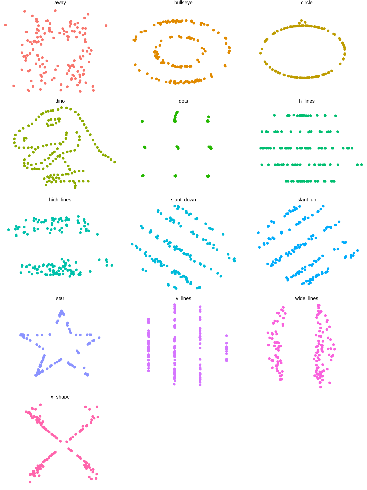

# The Datasaurus data package

This package wraps the awesome Datasaurus Dozen dataset, which contains
[13](https://www.phrases.org.uk/meanings/Bakers-dozen.html) sets of x-y
data. Each sub-dataset has five statistics that are (almost) the same in
each case. (These are the mean of x, mean of y, standard deviation of x,
standard deviation of y, and Pearson correlation between x and y).
However, scatter plots reveal that each sub-dataset looks very
different. The dataset is intended to be used to teach students that it
is important to plot their own datasets, rather than relying only on
statistics.

The Datasaurus was created by Alberto Cairo. Datasaurus shows us why
visualisation is important, not just summary statistics.

He’s been subsequently made even more famous in the paper [Same Stats,
Different Graphs: Generating Datasets with Varied Appearance and
Identical Statistics through Simulated
Annealing](https://www.research.autodesk.com/publications/same-stats-different-graphs/)
by Justin Matejka and George Fitzmaurice.

In the paper, Justin and George simulate a variety of datasets that the
same summary statistics to the Datasaurus but have very different
distributions.

This package looks to make these datasets available for use as an
advanced [Anscombe’s
Quartet](https://en.wikipedia.org/wiki/Anscombe%27s_quartet), available
in R as `anscombe`.

## Usage

To see that statistics are (almost) the same for each sub-dataset, you
can use `dplyr`.

``` r

library(datasauRus)
if (requireNamespace("dplyr")) {
  suppressPackageStartupMessages(library(dplyr))
  datasaurus_dozen %>%
    group_by(dataset) %>%
    summarize(
      mean_x    = mean(x),
      mean_y    = mean(y),
      std_dev_x = sd(x),
      std_dev_y = sd(y),
      corr_x_y  = cor(x, y)
    )
}
```

    ## Loading required namespace: dplyr

    ## # A tibble: 13 × 6
    ##    dataset    mean_x mean_y std_dev_x std_dev_y corr_x_y
    ##    <chr>       <dbl>  <dbl>     <dbl>     <dbl>    <dbl>
    ##  1 away         54.3   47.8      16.8      26.9  -0.0641
    ##  2 bullseye     54.3   47.8      16.8      26.9  -0.0686
    ##  3 circle       54.3   47.8      16.8      26.9  -0.0683
    ##  4 dino         54.3   47.8      16.8      26.9  -0.0645
    ##  5 dots         54.3   47.8      16.8      26.9  -0.0603
    ##  6 h_lines      54.3   47.8      16.8      26.9  -0.0617
    ##  7 high_lines   54.3   47.8      16.8      26.9  -0.0685
    ##  8 slant_down   54.3   47.8      16.8      26.9  -0.0690
    ##  9 slant_up     54.3   47.8      16.8      26.9  -0.0686
    ## 10 star         54.3   47.8      16.8      26.9  -0.0630
    ## 11 v_lines      54.3   47.8      16.8      26.9  -0.0694
    ## 12 wide_lines   54.3   47.8      16.8      26.9  -0.0666
    ## 13 x_shape      54.3   47.8      16.8      26.9  -0.0656

To see that each sub-dataset looks very different, you can draw scatter
plots.

``` r

if (requireNamespace("ggplot2")) {
  library(ggplot2)
  ggplot(datasaurus_dozen, aes(x = x, y = y, colour = dataset)) +
    geom_point() +
    theme_void() +
    theme(legend.position = "none") +
    facet_wrap(~dataset, ncol = 3)
}
```

    ## Loading required namespace: ggplot2


